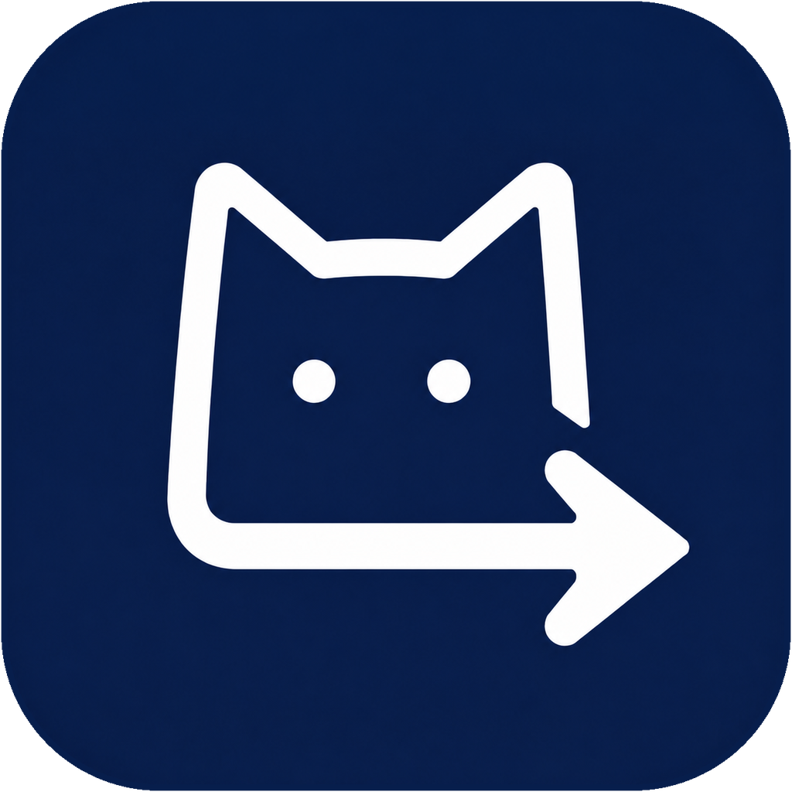

<div align="center">



# YuClash

A multi-platform proxy client based on ClashMeta. Simple to use, open source and ad-free.

**English** · [简体中文](README_zh_CN.md)

[](https://github.com/Little-Orange-Limited/YuClash/releases/latest)
[](https://github.com/Little-Orange-Limited/YuClash/releases)
[](LICENSE)

[Download](#download) · [Changelog](CHANGELOG.md) · [Build from source](#build-from-source)

</div>

<p align="center">
  <picture>
    <source media="(prefers-color-scheme: dark)" srcset="snapshots/preview-dark.png">
    
  </picture>
</p>

## Features

- **One app for Android, Windows, macOS and Linux**, with x64 and ARM64 builds on the desktop.
- **mihomo (Clash.Meta) core** with rule routing, proxy groups, latency tests, system proxy and TUN mode.
- **Profiles** from a subscription link or a file, with a built-in editor, override scripts, and custom rules,
  proxies and proxy groups.
- **Live views** of connections, requests, DNS queries and logs.
- **Material You design** with dynamic color, light and dark themes, and layouts that adapt from phones to desktops.
- **Backup and restore** through WebDAV or a local file.
- **Platform touches**: a Quick Settings tile, per-app proxy and Android TV support on Android; a tray menu and
  global hotkeys on the desktop.
- **Open source and ad-free**, licensed under GPL-3.0.

## Download

Get the latest build from [GitHub Releases](https://github.com/Little-Orange-Limited/YuClash/releases/latest).

| Platform | Packages | Notes |
| --- | --- | --- |
| Android | APK for `arm64-v8a`, `armeabi-v7a` and `x86_64` | Most phones use `arm64-v8a`. |
| Windows 10 and later | Installer (`.exe`) or portable `.zip`, for x64 and ARM64 | Pick ARM64 on Snapdragon and other ARM laptops. |
| macOS 12 and later | DMG for Apple Silicon and Intel | Also on Homebrew. |
| Linux | `.deb`, `.rpm` and AppImage, for x64 and ARM64 | See the tray note below. |

<p>
  <a href="https://github.com/Little-Orange-Limited/YuClash/releases/latest"></a>
</p>

**Homebrew**

```bash
brew tap Little-Orange-Limited/tap
brew install --cask yuclash
```

**Linux tray icon**

The `.deb` package installs its own dependencies. With the AppImage or the `.rpm`, install the AyatanaAppIndicator
library so the tray icon can show:

```bash
sudo apt-get install libayatana-appindicator3-1   # Debian and Ubuntu
sudo dnf install libayatana-appindicator-gtk3     # Fedora
```

## Usage

**Import a profile from a link.** Opening a link in this form imports the subscription into YuClash. The `clashmeta://`
and `yuclash://` schemes work the same way.

```text
clash://install-config?url=<URL-encoded subscription link>
```

**Automate on Android.** Tasker, MacroDroid and similar apps can start, stop or toggle the proxy by starting an
activity with one of these actions:

```text
com.yucloud.clash.action.START
com.yucloud.clash.action.STOP
com.yucloud.clash.action.TOGGLE
```

From a computer, the same works over adb:

```bash
adb shell am start -a com.yucloud.clash.action.TOGGLE
```

## Build from source

You need [Flutter](https://docs.flutter.dev/get-started/install) 3.47 (release builds use 3.47.4),
[Go](https://go.dev/dl/) 1.26 and [Rust](https://rustup.rs/) installed through rustup. Each platform builds on its own
host, except Android, which builds anywhere.

```bash
git clone --recursive https://github.com/Little-Orange-Limited/YuClash.git
cd YuClash
flutter pub get
dart setup.dart android   # or windows, macos, linux
```

Packages land in `dist/`. The Go core and the Rust libraries are compiled as part of the Flutter build. Set
`V2BOARD_BASE_URL` to a service-code JSON map before running `dart setup.dart`; the build bakes it into the app.

| Platform | Also needed |
| --- | --- |
| Android | Android SDK with the NDK. Add `--arch arm64` to build a single ABI. |
| Windows | GCC (MinGW-w64) for the core and [Inno Setup](https://jrsoftware.org/isinfo.php) 6 for the installer. |
| macOS | Xcode and Node.js. The script installs `appdmg` through npm. |
| Linux | Debian or Ubuntu. The script installs the build packages with apt and downloads `appimagetool`. |

Run `dart setup.dart --help` for the remaining options, such as `--targets` to build only some package formats.

## Support

Starring the repository is the easiest way to support the project. Questions, bugs and feature requests go to
[GitHub Issues](https://github.com/Little-Orange-Limited/YuClash/issues).

<a href="https://star-history.com/#Little-Orange-Limited/YuClash&Date">
  <picture>
    <source media="(prefers-color-scheme: dark)" srcset="https://api.star-history.com/svg?repos=Little-Orange-Limited/YuClash&type=Date&theme=dark">
    
  </picture>
</a>

## License

YuClash is released under the [GPL-3.0 license](LICENSE).
